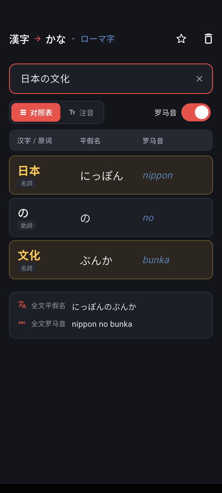
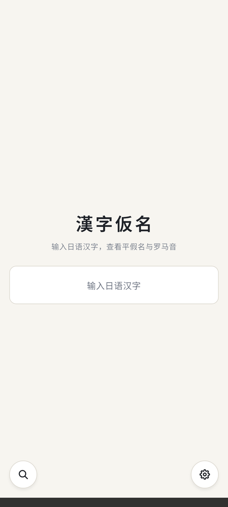
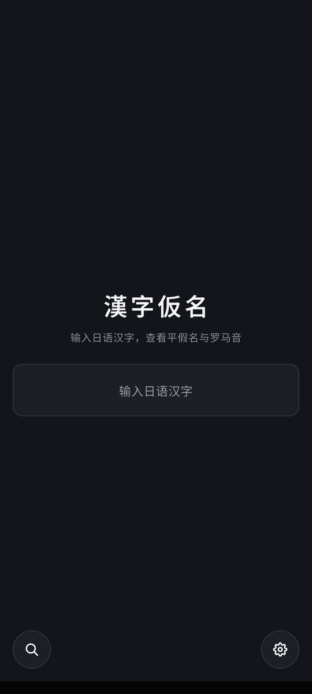

<div align="center">


# 漢字仮名

**Type Japanese kanji, instantly see the hiragana and romaji.**

An offline-first Flutter app for Android that lines up kanji, kana and romaji word by word
— like a translator's side-by-side view. Type a single kanji and it also looks up its
on'yomi and kun'yomi.

[](https://flutter.dev)
[](https://dart.dev)
[](#installation)
[](https://github.com/Aclguh/kanji-hiragana/releases/latest)
[](LICENSE)

[简体中文](README.md) · **English**

</div>

---

## Features

- **Kanji → hiragana → romaji** in a three-column, word-by-word table, powered by
  morphological analysis (kuromoji + IPADIC)
- **Conjugation base form hints**: identifies verb and adjective inflected forms and displays their dictionary base form (e.g., 食べた notes base form 食べる)
- **Multi-line paragraph preservation**: multi-line text input preserves paragraph breaks and formatting across Table, Furigana, and Vertical views
- **Export annotated text & vocabulary**: one-tap export as HTML `<ruby>` tags, bracket notation (e.g. `日本語(にほんご)`), or **Anki deck format** (tab-separated TSV containing surface, kana, romaji, meanings, and stroke notes)
- **Three switchable views**
  - **Table**: three columns side by side (kanji / hiragana / romaji) with primary & subcategory
    part-of-speech tags and loanword origin badges, plus summary footer to copy full kana and romaji
  - **Furigana**: textbook-style ruby, reading above the kanji and romaji below
  - **Vertical (縦書き)**: traditional Japanese vertical writing layout, right-to-left horizontal paging scroll, 90-degree rotated long vowel mark `ー`, readings aligned along the right side of kanji
- **System-native speech (TTS)**: uses the Android `TextToSpeech` engine for word-by-word and sentence playback; the app itself requests no network permission. If the selected system voice engine uses the network, the text is handled by that system service
- **Katakana loanword origins**: offline dictionary of loanword origins and etymology languages (e.g. コーヒー notes Dutch koffie, アルバイト notes German Arbeit, パン notes Portuguese pão) displayed via intuitive badges
- **Four-character idioms (四字熟語 / Yojijukugo)**: curated dictionary of four-character idioms with automated reverse lookup from single kanji details
- **214 Kangxi radical lookup table**: complete 214 Kangxi radical sheet mapped across 1..17 strokes, dynamically counting matching kanji in the database, tap to filter
- **Android system-level text selection query (PROCESS_TEXT)**: select Japanese text in any other Android app, choose "漢字仮名" from the context menu for instant lookup
- **Single-kanji detail**: type one kanji and get its **on'yomi** and **kun'yomi**
  together with Kangxi radical, romaji, stroke count, school grade, meanings, **four-character idioms**, **homophone recommendations** (kanji sharing on'yomi) and **common words**
  (with part-of-speech tags) containing the kanji; tap any common word, idiom, or homophone to query it directly or long-press to copy
- **History & favorites**: queries are remembered automatically and can be starred;
  the empty state lists them as tappable chips (long-press with haptic feedback to remove,
  history can be cleared at once). The star works in the app bar and in the filter detail page; starred vocabulary can be exported to Anki decks or plain text
- **Two-track readings**: standard spelling for annotation, plus the actual pronunciation
  - 東京 is annotated `とうきょう` with a pronunciation note of `とーきょー`
  - The particle は is annotated `は` with a note that it reads `わ`
    (highlighted in vermilion — exactly the grammar point worth learning)
- **Multi-dimensional kanji filter**:
  - Strokes and frequency both accept an arbitrary range (lower ~ upper, leave blank for no bound)
  - **Reverse reading lookup**: enter hiragana or katakana to find matching kanji
  - **Meaning search**: search by English or Chinese keyword
  - **Radical filter**: filter by common radicals (water, wood, person, hand, heart, speech, etc.) or open the 214 Kangxi radical sheet for full selection
  - Reading composition and school grade conditions, sortable, with active criteria summary chips on the results page, and tap into any cell for details & favorites
- **Interface language**: switch between 简体中文 and English (Settings → Language).
  Every UI string *and* the kanji meanings follow the switch. The four characters
  漢字仮名 stay in traditional form as the app's mark
- **Settings**: theme (light / dark / follow system, system bars adaptively match),
  auto-rotate switch (off by default), about page
- **Simplified Chinese to Japanese Shinjitai conversion**: enter Simplified Chinese characters (e.g. 练习 automatically converts to 練習, 单 to 単, 发 to 発) and seamlessly look up words or kanji details
- **Confirm-to-search interaction**: entering text stays on the main screen with a right-arrow button; tap the arrow to enter the search interface. Modifying text inside the search view does not immediately reload, refreshing only when the arrow button is tapped
- **Focus-first main screen**: opens with a single centred input box, then animates into the full interface upon searching
- **Offline app logic**: the dictionary ships with the app — the app makes no network calls, requests no extra permissions, and has no ads

## Screenshots

<div align="center">

| Empty state | Table |
| :---: | :---: |
|  |  |
| Opens with just a centred input box | Word-by-word columns, the current word highlighted in vermilion |

| Light theme | Dark theme |
| :---: | :---: |
|  |  |
| Light: paper-white background with ink-dark text | Dark: the same screen recoloured, preferences persisted |

</div>

## Installation

### Install the APK directly

Download the APK for your architecture from
[Releases](https://github.com/Aclguh/kanji-hiragana/releases/latest):

| File | Devices | Size |
| --- | --- | --- |
| `app-arm64-v8a-release.apk` | Almost all modern phones (**recommended**) | 40.6 MB |
| `app-armeabi-v7a-release.apk` | Older 32-bit devices | 38.8 MB |
| `app-x86_64-release.apk` | Emulators / x86 tablets | 42.0 MB |

> If you are unsure, install `arm64-v8a`. The wrong architecture reports
> "App not installed".

### Build from source

```bash
git clone https://github.com/Aclguh/kanji-hiragana.git
cd kanji-hiragana
flutter pub get
flutter build apk --release --split-per-abi
# Output: build/app/outputs/flutter-apk/app-arm64-v8a-release.apk
```

> The repository does not contain a signing key. Without `android/key.properties`,
> release builds automatically fall back to the debug signature — installable and
> usable, but not suitable for distribution. To publish your own builds, put your key
> in `android/key.properties`; that file and `*.jks` are already excluded by
> `.gitignore`.

## Usage

1. Open the app and type Japanese or Simplified Chinese (e.g. 练习) into the centred input box, or tap the clipboard button to paste
2. Tap the right-arrow button next to the input box to enter the search view:
   - **Several characters** → automatically normalized to Japanese Shinjitai (e.g. 練習) and displayed in the word-by-word Table, Furigana view, or Vertical view
   - **A single kanji** → additionally its on'yomi, kun'yomi, meanings, four-character idioms, and common words
3. Modifying text inside the search view does not interrupt reading; tap the right arrow to refresh
4. Switch between **Table**, **Furigana**, and **Vertical** at the top
5. Tap any word to hear system-native pronunciation and copy it, or use the top-right action to copy the full kana
6. Tap the **star** in the app bar to favorite the current query; when the keyboard is
   dismissed, the empty state shows **Recent / Favorites** chips — tap one to look it
   up again (long-press removes a chip; history can be cleared at once; starred vocabulary can be exported as an Anki deck)
7. The gear at the bottom right opens **Settings** (theme / auto-rotate / language /
   about); the magnifier at the bottom left opens **Filter** (find kanji by strokes,
   frequency, 214 Kangxi radicals, and more)
8. Select Japanese text in any other app on Android and choose **漢字仮名** in the context menu for instant lookup

## How it works

| Stage | Implementation |
| --- | --- |
| Simplified Chinese to Shinjitai | Built-in 2720-character mapping and exceptions dictionary, see `lib/core/kanji_converter.dart` |
| Tokenization and readings | [`kuromoji`](https://pub.dev/packages/kuromoji) (Atilika IPADIC, pure Dart) |
| On'yomi / kun'yomi | 2999 common kanji extracted from KANJIDIC2, see `lib/core/kanji_reading_dict.dart` |
| Common words | ~20k collocations extracted at build time from the IPADIC embedded in kuromoji, see `lib/core/kanji_words_dict.dart` |
| 214 Kangxi radicals | Complete 214 Kangxi radical table with 1..17 stroke mappings, see `lib/core/radical_dict.dart` |
| Katakana loanwords | Curated loanword dictionary with origin language codes, see `lib/core/loanwords_dict.dart` |
| Four-character idioms | Curated yojijukugo dictionary and single-kanji reverse index, see `lib/core/yojijukugo_dict.dart` |
| System speech (TTS) | Android native `TextToSpeech` platform channel, see `lib/core/tts_service.dart`; network use depends on the selected system engine |
| Cross-app text query | Android `ACTION_PROCESS_TEXT` intent platform channel, see `lib/core/platform_service.dart` |
| Katakana → hiragana | Code-point offset (`0x30A1 - 0x3041`) |
| Hiragana → romaji | Hand-written modified Hepburn romanisation |
| Settings & history | [`shared_preferences`](https://pub.dev/packages/shared_preferences) persistence (theme / language / view state / query history & favorites) |
| Icons | Hand-drawn vector paths via `CustomPainter` (gear / magnifier) — no icon font, no emoji |
| State and UI | Flutter Material 3, with light and dark Japanese-style themes, supporting Table, Furigana, and Vertical views |
| Localization | `AppStrings` sealed class with `ZhStrings` / `EnStrings`, injected through `AppStringsScope` |

### Why two tracks for readings

kuromoji returns two different fields for the same word, with different purposes:

| Field | 東京 | は (particle) | Character |
| --- | --- | --- | --- |
| `reading` | トウキョウ | ハ | Standard kana spelling, good for annotation |
| `pronunciation` | トーキョー | ワ | Actual speech; long vowels written with `ー` |

**The app uses both.** Kana annotation and romaji come from `reading` so the spelling is
standard and matches a dictionary. The real pronunciation is listed underneath as
`pronunciation`, with particle shifts (は→わ, へ→え, を→お) highlighted in vermilion.

Using only `pronunciation` would produce spellings like 東京 → とーきょー that you cannot
look up. Using only `reading` would hide how the word is actually said. Two tracks is the
only way to lose no information.

### About on'yomi / kun'yomi

IPADIC returns only the single most common reading for a character and **does not
distinguish on'yomi from kun'yomi**, so that data is extracted separately from
[KANJIDIC2](https://www.edrdg.org/wiki/index.php/KANJIDIC_Project) (CC BY-SA 4.0),
covering 2999 kyōiku / jōyō / jinmeiyō kanji with their `ja_on` and `ja_kun` fields.

Kun'yomi notation:

| KANJIDIC2 | Shown in the app | Meaning |
| --- | --- | --- |
| `まな.ぶ` | `まな(ぶ)` | The dot marks the okurigana boundary |
| `-び` / `び-` | `(び)` | Affix only, never a standalone word |

Parentheses are stripped when deriving romaji (`まな(ぶ)` → `manabu`).

### Meanings in two languages

KANJIDIC2's meanings are English natively; the generator maps them to Chinese for the
Chinese interface and keeps the English originals in a separate `meaningsEn` field. The
English UI therefore shows KANJIDIC2's own wording rather than a back-translation.

## Project layout

```
lib/
  main.dart                  Entry point: loads settings & query history, warms up the dictionary
  theme.dart                 Light / dark Japanese-style palettes (AppColors ThemeExtension)
  home_page.dart             Main page: focus-style input, view switch, history/favorite chips, floating buttons
  core/
    kana_romaji.dart         Kana ↔ romaji conversion (the core algorithm)
    morpheme.dart            Word and analysis-result models (two-track readings & Anki export)
    japanese_analyzer.dart   Morphological analysis (persistent isolate, timeout & recovery)
    analyzer_service.dart    Analyzer interface for test injection
    analyzer_failure.dart    Typed analysis failures
    diagnostics.dart         Local ring-buffer diagnostics (no query text)
    speech_service.dart      Speech service interface
    platform_text_source.dart Cross-app text source interface
    kanji_reading_dict.dart  [GENERATED] on'yomi / kun'yomi for 2999 kanji
    kanji_words_dict.dart    [GENERATED] common words per kanji (extracted from IPADIC)
    kanji_converter.dart     Simplified Chinese to Japanese Shinjitai kanji conversion
    radical_dict.dart        214 Kangxi radicals and stroke index table
    loanwords_dict.dart      Katakana loanwords dictionary and origin language tags
    yojijukugo_dict.dart     Curated four-character idioms dictionary and reverse index
    tts_service.dart         System TTS speech client service
    platform_service.dart    Android cross-app PROCESS_TEXT intent platform service
    kanji_filter.dart        Filter model and matching logic
    query_store.dart         Persisted query history & favorites
    settings.dart            Persisted theme / auto-rotate / language / view state
    strings.dart             zh + en UI strings (AppStrings sealed class)
  widgets/
    app_scopes.dart          String and service scope injection
    filter/filter_controls.dart Filter fields, ranges and chips
    home/home_coordinator.dart Home business coordinator
    home/home_chrome.dart    Top bar, floating buttons, long-result notice, state views
    home/home_result_sliver.dart Lazy result sliver
    alignment_table.dart     Three-column table view
    furigana_view.dart       Furigana (ruby) view
    vertical_view.dart       Traditional Japanese vertical writing view (RTL horizontal progression)
    single_kanji_view.dart   Single-kanji on'yomi / kun'yomi + idioms + common words detail
    radical_picker_sheet.dart 214 Kangxi radical picker bottom sheet
    anki_export_sheet.dart   Vocabulary Anki / TSV export bottom sheet
    sliding_drawer.dart      Side drawer shell (panel + scrim)
    settings_drawer.dart     Settings drawer content
    filter_drawer.dart       Filter drawer content (includes radical picker trigger)
    filter_result_page.dart  Full-screen filter result grid
    about_page.dart          About page (version / repository / licenses / credits)
    vector_icon.dart         Hand-drawn vector icons (gear / magnifier)
test/
  core_test.dart             Core unit tests (incl. Unicode, HTML escaping, diagnostics and recovery)
  widget_test.dart           Host-side widget tests for heavy widgets (filter, drawer, vertical, radicals, Anki, single kanji)
  golden_test.dart           Platform-specific Golden visual regression
  support/fake_services.dart Analyzer / speech / text-source test doubles
integration_test/
  ui_test.dart               On-device UI tests (core user journeys & bilingual support)
tool/
  verify.dart                Standalone verification (assertion count comes from its output)
  check_coverage.dart        Overall and per-module coverage gates
  gen_kanji_dict.py          KANJIDIC2 → Dart data generator
  gen_kanji_words.py         kuromoji-embedded IPADIC → common-word data generator
  gen_icon.py                App icon generator (needs Pillow, see requirements.txt)
  requirements.txt           Python dependencies for tool/
  data/                      KANJIDIC2 source data (.gz only, ~1.5 MB)
```

## Development

```bash
flutter pub get

# Static analysis
flutter analyze

# Logic verification (no flutter_test needed, runs anywhere)
dart run tool/verify.dart

# Unit + widget tests (no device needed)
flutter test

# Golden visual regression (platform baselines under test/goldens/)
GOLDEN=1 flutter test test/golden_test.dart

# On-device UI tests (requires a connected device, final gate)
flutter test integration_test/ui_test.dart -d <device-id>

# Run over USB
flutter run -d <device-id> --release
```

### Regenerating the data file

The dictionary is pre-generated Dart source; day-to-day development does not need this.
Only run it when updating the dictionary data:

```bash
# 1. Download KANJIDIC2 (~1.5 MB gzip)
curl -L -o tool/data/kanjidic2.xml.gz \
  https://www.edrdg.org/kanjidic/kanjidic2.xml.gz

# 2. Generate lib/core/kanji_reading_dict.dart
python tool/gen_kanji_dict.py

# 3. Generate lib/core/kanji_words_dict.dart (common words per kanji)
#    Decodes the IPADIC embedded in the local kuromoji package — no download
#    needed, but flutter pub get must have run at least once.
python tool/gen_kanji_words.py
```

The first script reads the `.gz` directly; the second decodes the package's embedded
binary dictionary. Both pick out the kyōiku / jōyō / jinmeiyō kanji.
(The 16 MB decompressed XML is not kept in the repository; it is excluded by
`.gitignore`.)

The app icon is generated too — re-run this after changing the design
(install Pillow first with `pip install -r tool/requirements.txt`):

```bash
python tool/gen_icon.py   # writes to android/app/src/main/res/
```

### About the size

kuromoji embeds the IPADIC dictionary as gzip-compressed Dart source (~23 MB of source),
plus ~0.7 MB of common-word data, which dominates the APK size. To slim it down,
**always split by ABI**:

```bash
flutter build apk --release --split-per-abi
```

Each APK then contains a single architecture and is considerably smaller.

## Data sources and licenses

- **Application code**: [MIT](LICENSE)
- **On'yomi / kun'yomi / meanings**:
  [KANJIDIC2](https://www.edrdg.org/wiki/index.php/KANJIDIC_Project), copyright
  Electronic Dictionary Research and Development Group, released under
  [CC BY-SA 4.0](https://creativecommons.org/licenses/by-sa/4.0/).
  `lib/core/kanji_reading_dict.dart` is a derivative work and is likewise provided under
  CC BY-SA 4.0.
- **Tokenization, readings and common words**: [kuromoji](https://pub.dev/packages/kuromoji)
  and [IPADIC](https://www.atilika.com), Apache License 2.0.
  `lib/core/kanji_words_dict.dart` is derivative data extracted from IPADIC
  (ordering references KANJIDIC2's frequency field), likewise under Apache License 2.0.

## Credits

- [kuromoji](https://github.com/takuyaa/kuromoji.js) — the pure-Dart port of the
  morphological analyzer
- [KANJIDIC2](https://www.edrdg.org/wiki/index.php/KANJIDIC_Project) — kanji readings and
  meanings
- [Atilika](https://www.atilika.com) — the IPADIC dictionary
